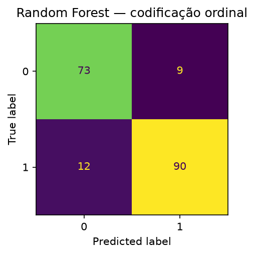
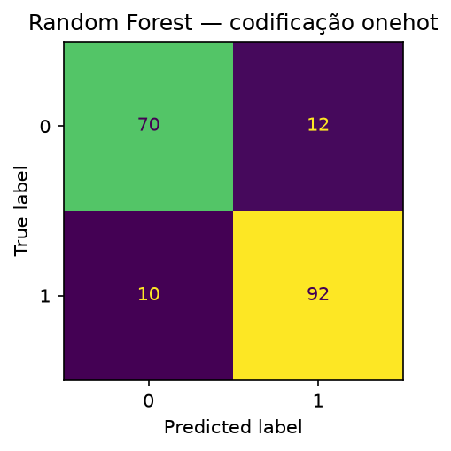
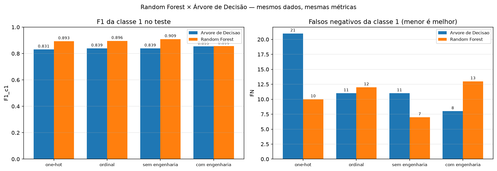
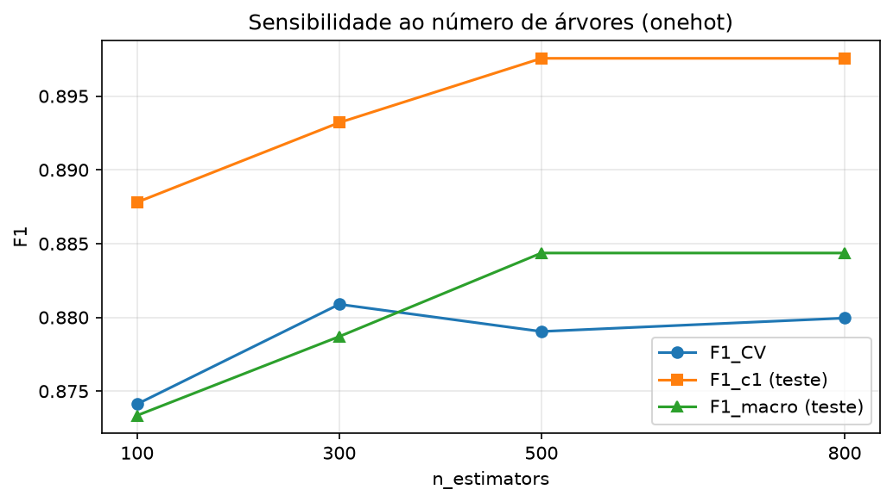
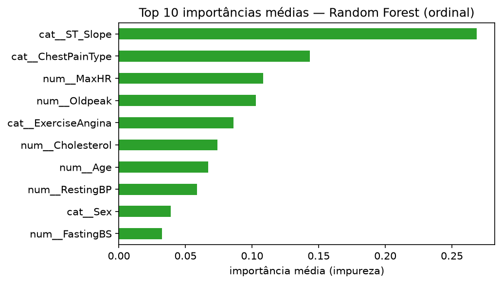
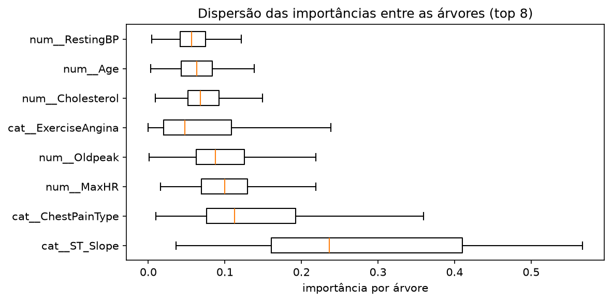
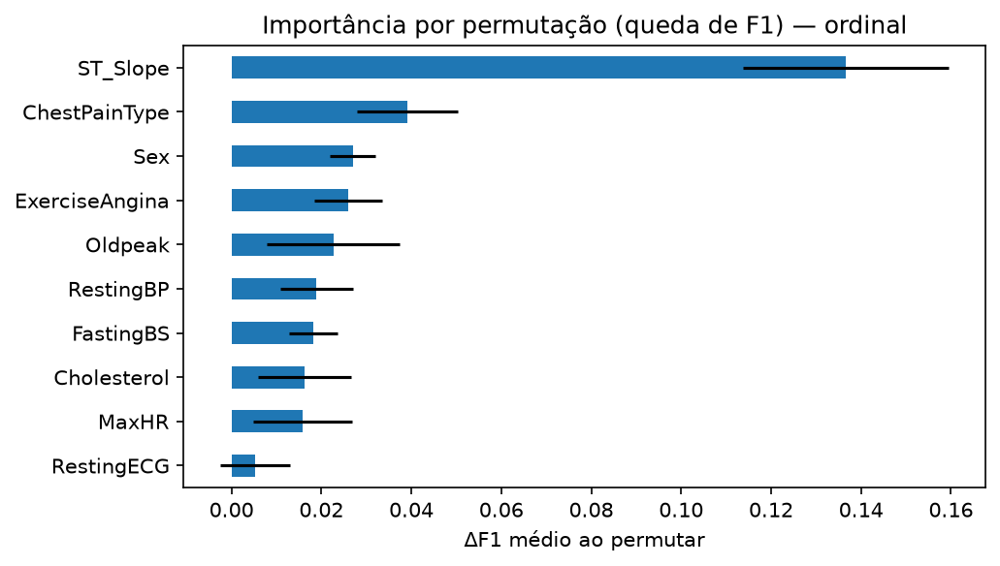
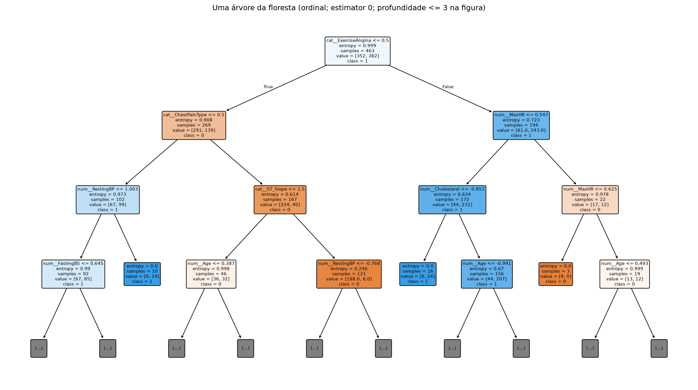

```{=openxml}
<w:p><w:pPr><w:spacing w:before="0" w:after="0" w:line="360" w:lineRule="auto"/></w:pPr></w:p>
<w:p><w:pPr><w:spacing w:before="0" w:after="0" w:line="360" w:lineRule="auto"/></w:pPr></w:p>
<w:p><w:pPr><w:spacing w:before="0" w:after="0" w:line="360" w:lineRule="auto"/><w:jc w:val="center"/></w:pPr><w:r><w:rPr><w:rFonts w:ascii="Times New Roman" w:hAnsi="Times New Roman"/><w:b/><w:sz w:val="24"/><w:szCs w:val="24"/></w:rPr><w:t>UNIVERSIDADE FEDERAL DO PIAUÍ</w:t></w:r></w:p>
<w:p><w:pPr><w:spacing w:before="0" w:after="0" w:line="360" w:lineRule="auto"/><w:jc w:val="center"/></w:pPr><w:r><w:rPr><w:rFonts w:ascii="Times New Roman" w:hAnsi="Times New Roman"/><w:b/><w:sz w:val="24"/><w:szCs w:val="24"/></w:rPr><w:t>PROGRAMA DE PÓS-GRADUAÇÃO EM CIÊNCIA DA COMPUTAÇÃO</w:t></w:r></w:p>
<w:p><w:pPr><w:spacing w:before="0" w:after="0" w:line="360" w:lineRule="auto"/></w:pPr></w:p>
<w:p><w:pPr><w:spacing w:before="0" w:after="0" w:line="360" w:lineRule="auto"/></w:pPr></w:p>
<w:p><w:pPr><w:spacing w:before="0" w:after="0" w:line="360" w:lineRule="auto"/><w:jc w:val="center"/></w:pPr><w:r><w:rPr><w:rFonts w:ascii="Times New Roman" w:hAnsi="Times New Roman"/><w:b/><w:sz w:val="24"/><w:szCs w:val="24"/></w:rPr><w:t>Disciplina: Aprendizado de Máquina</w:t></w:r></w:p>
<w:p><w:pPr><w:spacing w:before="0" w:after="0" w:line="360" w:lineRule="auto"/></w:pPr></w:p>
<w:p><w:pPr><w:spacing w:before="0" w:after="0" w:line="360" w:lineRule="auto"/></w:pPr></w:p>
<w:p><w:pPr><w:spacing w:before="0" w:after="0" w:line="360" w:lineRule="auto"/></w:pPr></w:p>
<w:p><w:pPr><w:spacing w:before="0" w:after="0" w:line="360" w:lineRule="auto"/><w:jc w:val="center"/></w:pPr><w:r><w:rPr><w:rFonts w:ascii="Times New Roman" w:hAnsi="Times New Roman"/><w:b/><w:sz w:val="28"/><w:szCs w:val="28"/></w:rPr><w:t>Predição de Doença Cardíaca com Random Forest:</w:t></w:r></w:p>
<w:p><w:pPr><w:spacing w:before="0" w:after="0" w:line="360" w:lineRule="auto"/><w:jc w:val="center"/></w:pPr><w:r><w:rPr><w:rFonts w:ascii="Times New Roman" w:hAnsi="Times New Roman"/><w:b/><w:sz w:val="28"/><w:szCs w:val="28"/></w:rPr><w:t>comparação com a Árvore de Decisão</w:t></w:r></w:p>
<w:p><w:pPr><w:spacing w:before="0" w:after="0" w:line="360" w:lineRule="auto"/></w:pPr></w:p>
<w:p><w:pPr><w:spacing w:before="0" w:after="0" w:line="360" w:lineRule="auto"/></w:pPr></w:p>
<w:p><w:pPr><w:spacing w:before="0" w:after="0" w:line="360" w:lineRule="auto"/><w:jc w:val="right"/></w:pPr><w:r><w:rPr><w:rFonts w:ascii="Times New Roman" w:hAnsi="Times New Roman"/><w:sz w:val="24"/><w:szCs w:val="24"/></w:rPr><w:t>Integrantes:</w:t></w:r></w:p>
<w:p><w:pPr><w:spacing w:before="0" w:after="0" w:line="360" w:lineRule="auto"/><w:jc w:val="right"/></w:pPr><w:r><w:rPr><w:rFonts w:ascii="Times New Roman" w:hAnsi="Times New Roman"/><w:sz w:val="24"/><w:szCs w:val="24"/></w:rPr><w:t>Arthur Fernando Elvas Bohn (20261001997)</w:t></w:r></w:p>
<w:p><w:pPr><w:spacing w:before="0" w:after="0" w:line="360" w:lineRule="auto"/><w:jc w:val="right"/></w:pPr><w:r><w:rPr><w:rFonts w:ascii="Times New Roman" w:hAnsi="Times New Roman"/><w:sz w:val="24"/><w:szCs w:val="24"/></w:rPr><w:t>Diego Cordeiro de Oliveira (20261002180)</w:t></w:r></w:p>
<w:p><w:pPr><w:spacing w:before="0" w:after="0" w:line="360" w:lineRule="auto"/><w:jc w:val="right"/></w:pPr><w:r><w:rPr><w:rFonts w:ascii="Times New Roman" w:hAnsi="Times New Roman"/><w:sz w:val="24"/><w:szCs w:val="24"/></w:rPr><w:t>Keoma de Sousa Coelho (20261004952)</w:t></w:r></w:p>
<w:p><w:pPr><w:spacing w:before="0" w:after="0" w:line="360" w:lineRule="auto"/></w:pPr></w:p>
<w:p><w:pPr><w:spacing w:before="0" w:after="0" w:line="360" w:lineRule="auto"/><w:jc w:val="right"/></w:pPr><w:r><w:rPr><w:rFonts w:ascii="Times New Roman" w:hAnsi="Times New Roman"/><w:sz w:val="24"/><w:szCs w:val="24"/></w:rPr><w:t>Professor: Dr. Vinicius Ponte Machado</w:t></w:r></w:p>
<w:p><w:pPr><w:spacing w:before="0" w:after="0" w:line="360" w:lineRule="auto"/></w:pPr></w:p>
<w:p><w:pPr><w:spacing w:before="0" w:after="0" w:line="360" w:lineRule="auto"/></w:pPr></w:p>
<w:p><w:pPr><w:spacing w:before="0" w:after="0" w:line="360" w:lineRule="auto"/></w:pPr></w:p>
<w:p><w:pPr><w:spacing w:before="0" w:after="0" w:line="360" w:lineRule="auto"/><w:jc w:val="center"/></w:pPr><w:r><w:rPr><w:rFonts w:ascii="Times New Roman" w:hAnsi="Times New Roman"/><w:sz w:val="24"/><w:szCs w:val="24"/></w:rPr><w:t>Teresina, 30 de outubro de 2026</w:t></w:r></w:p>
<w:p><w:r><w:br w:type="page"/></w:r></w:p>
```

**Disciplina:** Aprendizado de Máquina — PPGCC/UFPI  
**Professor:** Doutor Vinicius Ponte Machado  
**Data:** 30/10/2026  

**Integrantes:**

| Integrante | Matrícula |
|---|---|
| Arthur Fernando Elvas Bohn | 20261001997 |
| Diego Cordeiro de Oliveira | 20261002180 |
| Keoma de Sousa Coelho | 20261004952 |

**Base:** [Heart Failure Prediction — Kaggle](https://www.kaggle.com/datasets/fedesoriano/heart-failure-prediction)  
**Notebook:** `docs/handle_forest/Random_Forest_Heart_Failure_mlflow.ipynb`  
**Referência de comparação:** `Arvore_Decisao_Heart_Failure_mlflow.ipynb` (experimento `heart_failure_arvore_decisao`)

---

## Lista de siglas e abreviaturas

| Sigla | Significado |
|---|---|
| **BP** | Pressão arterial (*Blood Pressure*) |
| **CV** | Validação cruzada (*Cross-Validation*) |
| **DAC** | Doença arterial coronariana |
| **ECG** | Eletrocardiograma |
| **F1** | Média harmônica entre precisão e revocação |
| **FC** | Frequência cardíaca |
| **FN** | Falso negativo |
| **FP** | Falso positivo |
| **HR** | Frequência cardíaca (*Heart Rate*) |
| **IC 95%** | Intervalo de confiança de 95% |
| **LVH** | Hipertrofia ventricular esquerda (*Left Ventricular Hypertrophy*) |
| **M/F** | Masculino/feminino |
| **MLflow** | Plataforma de rastreamento de experimentos de aprendizado de máquina |
| **OOB** | *Out-of-bag* (amostras não sorteadas no bootstrap de cada árvore) |
| **PCA** | Análise de Componentes Principais (*Principal Component Analysis*) |
| **PPGCC/UFPI** | Programa de Pós-Graduação em Ciência da Computação da Universidade Federal do Piauí |
| **Prec. / Rec.** | Precisão / revocação (*recall*) |
| **RF** | Random Forest (floresta aleatória) |
| **SHAP** | *SHapley Additive exPlanations* |
| **SMOTE** | *Synthetic Minority Over-sampling Technique* (sobreamostragem sintética) |
| **SQLite** | Banco de dados relacional leve |
| **ST** | Segmento ST do eletrocardiograma |
| **TA/ATA/NAP/ASY** | Angina típica / angina atípica / dor não anginosa / assintomático |
| **TN / TP** | Verdadeiro negativo / verdadeiro positivo |
| **UCI** | *University of California, Irvine* (repositório de conjuntos de dados) |
| **Y/N** | Sim/não |

---

## 1. Introdução e problema

As doenças cardiovasculares estão entre as principais causas de morte no mundo. Um modelo de triagem que identifique pacientes com maior probabilidade de doença cardíaca pode apoiar a priorização de exames e reduzir o tempo até o tratamento. O problema é uma **classificação binária**:

- **Classe 1:** paciente com doença cardíaca (`HeartDisease = 1`);
- **Classe 0:** paciente sem doença (`HeartDisease = 0`).

O erro de maior gravidade clínica é o **falso negativo da classe 1**: classificar um paciente doente como "não doente". Por isso, além da acurácia, este trabalho dá atenção especial ao **recall e ao F1 da classe 1** (e ao F1 macro, que equilibra as duas classes).

**Objetivo:** repetir com **Random Forest** exatamente as estratégias já aplicadas à **Árvore de Decisão** — tratamento dos dados, busca em grade, ablação e engenharia de atributos — e **comparar as duas abordagens** de forma reprodutível, com todos os experimentos registrados no **MLflow**.

**Por que a comparação é justa:** as duas abordagens usam o **mesmo split estratificado 80/20 (semente 42)**, a **mesma validação cruzada** (`RepeatedStratifiedKFold`, 5 folds × 2 repetições), a **mesma grade** (864 combinações por codificação) e as **mesmas métricas**. A única diferença é o estimador: uma árvore única (`DecisionTreeClassifier`) contra uma floresta de 300 árvores (`RandomForestClassifier`).

---

## 2. Base de dados

### 2.1 Origem e descrição

A base é a **Heart Failure Prediction** (Kaggle, fedesoriano), derivada do **UCI Heart Disease** (Detrano et al., 1989), combinando cinco bases clínicas (Cleveland, Hungria, Suíça, Long Beach VA e Statlog). O arquivo `bases/heart.csv` contém **918 registros** e **12 colunas** (11 atributos + alvo). Como a base é a mesma da etapa da árvore, esta seção é resumida; o foco do documento está na comparação de resultados.

### 2.2 Dicionário de atributos

| Atributo | Tipo | Descrição |
|---|---|---|
| `Age` | Numérico | Idade (anos) |
| `Sex` | Categórico | Sexo (M/F) |
| `ChestPainType` | Categórico | Tipo de dor no peito (TA, ATA, NAP, ASY) |
| `RestingBP` | Numérico | Pressão arterial em repouso (mm Hg) |
| `Cholesterol` | Numérico | Colesterol sérico (mm/dl) |
| `FastingBS` | Binário | Glicemia em jejum > 120 mg/dl (1/0) |
| `RestingECG` | Categórico | ECG em repouso (Normal, ST, LVH) |
| `MaxHR` | Numérico | Frequência cardíaca máxima atingida |
| `ExerciseAngina` | Categórico | Angina induzida por exercício (Y/N) |
| `Oldpeak` | Numérico | Depressão do segmento ST induzida por exercício |
| `ST_Slope` | Categórico | Inclinação do segmento ST no pico (Up/Flat/Down) |
| `HeartDisease` | Binário | Alvo: 1 = doença, 0 = normal |

**Legenda:** `TA` = angina típica; `ATA` = angina atípica; `NAP` = dor não anginosa; `ASY` = assintomático; `M/F` = masculino/feminino; `Y/N` = sim/não; `ST` = segmento ST do eletrocardiograma; `LVH` = hipertrofia ventricular esquerda.

### 2.3 Distribuição e qualidade

| Classe | Registros | Proporção |
|---|---|---|
| 1 (com doença) | 508 | 55,34% |
| 0 (sem doença) | 410 | 44,66% |
| **Total** | **918** | **100%** |

- **Desbalanceamento leve:** a classe 1 é majoritária (55,34%).
- **Valores ausentes:** não há `NaN` original; porém `Cholesterol` tem **172 zeros** e `RestingBP` tem **1 zero**, fisiologicamente implausíveis. Esses zeros são convertidos em `NaN` e imputados **dentro do pipeline** (sem vazamento).
- **Duplicatas:** 0.
- **Split:** 80/20 estratificado → 734 treino e 184 teste (102 da classe 1 e 82 da classe 0 no teste).

### 2.4 Estatísticas descritivas

| Variável | Média | Desvio | Mín. | Mediana | Máx. |
|---|---:|---:|---:|---:|---:|
| Age | 53,51 | 9,43 | 28,00 | 54,00 | 77,00 |
| RestingBP | 132,40 | 18,51 | 0,00 | 130,00 | 200,00 |
| Cholesterol | 198,80 | 109,38 | 0,00 | 223,00 | 603,00 |
| FastingBS | 0,23 | 0,42 | 0,00 | 0,00 | 1,00 |
| MaxHR | 136,81 | 25,46 | 60,00 | 138,00 | 202,00 |
| Oldpeak | 0,89 | 1,07 | -2,60 | 0,60 | 6,20 |

---

## 3. Metodologia

### 3.1 Fluxo de processamento (pipeline)

O modelo é uma **floresta aleatória** (`RandomForestClassifier`) dentro de um fluxo de processamento (`Pipeline`) idêntico ao da árvore:

1. **Pré-processamento numérico:** `SimpleImputer` (estratégia testada: mediana, média, moda) + `StandardScaler`;
2. **Pré-processamento categórico:** `OneHotEncoder` ou `OrdinalEncoder` (comparados);
3. **Modelo:** `RandomForestClassifier` com `n_estimators = 300`.

Tudo é ajustado **somente no treino de cada partição (fold)** da validação cruzada, evitando vazamento.

### 3.2 Validação e seleção

- Divisão estratificada 80/20 (semente 42); o conjunto de teste é reservado até o fim.
- `RepeatedStratifiedKFold(5 folds × 2 repetições)` para a busca.
- `GridSearchCV` com métrica de reajuste (refit) **F1 da classe 1**; acurácia, precisão e recall também são medidos.
- Grade: imputação (3) × `criterion` (2) × `max_depth` (4) × `min_samples_split` (3) × `min_samples_leaf` (3) × `max_features` (2) × `class_weight` (2) = **864 combinações** por codificação; 8.640 ajustes por codificação; **17.280 ajustes** no total (one-hot + ordinal).

**Valores testados em cada hiperparâmetro:**

| Parâmetro | Valores testados |
|---|---|
| `prep__num__imp__strategy` | `median`, `mean`, `most_frequent` |
| `modelo__criterion` | `gini`, `entropy` |
| `modelo__max_depth` | `3`, `5`, `7`, `None` |
| `modelo__min_samples_split` | `2`, `5`, `10` |
| `modelo__min_samples_leaf` | `1`, `3`, `5` |
| `modelo__max_features` | `None`, `sqrt` |
| `modelo__class_weight` | `None`, `balanced` |
| `modelo__n_estimators` | `300` (fixo na busca; avaliado à parte em 100, 300, 500 e 800) |

- Avaliação no teste: acurácia, precisão, recall e F1 para **as duas classes**, F1 macro, IC 95% do F1 da classe 1 (bootstrap com 1.000 reamostragens), matriz de confusão e contagem de FN/FP.

### 3.3 Fases do notebook

| Fase | O que faz |
|---|---|
| 1. Configuração | Semente, MLflow (SQLite compartilhado), pastas `docs/handle_forest/...` |
| 2. Carga/limpeza | Lê `bases/heart.csv`; zeros de `Cholesterol`/`RestingBP` → `NaN` |
| 3. Preparação | `ColumnTransformer` (imputação + encoding + scaler), split 80/20, CV 5×2 |
| 4. Grid search | 864 combinações por codificação; one-hot e ordinal; OOB score; log no MLflow |
| 5. Avaliação | Métricas das duas classes, IC 95%, matriz de confusão, FN/FP, importâncias |
| 6. Baseline | `DummyClassifier(most_frequent)` como referência |
| 7. Interpretação | Importância média e dispersão entre árvores, árvore representativa, permutação, invariância à escala |
| 8. Ablação | Remove 1 atributo por vez; mesmos hiperparâmetros; ambas as classes |
| 9. Engenharia | 5 razões/interações clínicas; comparação sem/com |
| 10. Nº de árvores | 100, 300, 500 e 800 árvores com os melhores parâmetros |
| 11. Comparação | Tabelas e gráfico RF × árvore; deltas registrados no MLflow |
| 12. Exportação | CSVs, JSON, PNGs e ZIP; artefatos no MLflow |
| 13. Consulta | Exportação das runs dos dois experimentos para CSV |

### 3.4 Engenharia de atributos testada

| Atributo derivado | Fórmula | Motivação |
|---|---|---|
| `FC_pct_teorica` | `MaxHR / (220 − Age)` | % da FC máxima teórica |
| `Chol_por_Idade` | `Cholesterol / Age` | colesterol relativo à idade |
| `BP_por_Idade` | `RestingBP / Age` | pressão relativa à idade |
| `Oldpeak_por_FC` | `Oldpeak / MaxHR` | depressão ST por batimento |
| `Angina_x_Oldpeak` | `(ExerciseAngina == 'Y') × Oldpeak` | interação angina × ST |

As razões são calculadas **linha a linha**, antes da divisão (split), sem vazamento.

### 3.5 Recursos específicos do Random Forest

- **OOB score:** cada árvore é treinada em uma amostra bootstrap; as observações deixadas de fora funcionam como validação interna. O OOB é registrado como métrica adicional (não participa da seleção, para manter o critério igual ao da árvore).
- **Dispersão das importâncias:** a importância é calculada em cada uma das 300 árvores; reporta-se média, desvio e quartis. Uma variável com importância alta mas muito instável entre árvores é menos confiável.
- **Importância por permutação:** mede a queda de F1 no teste ao embaralhar cada atributo original — complementa a importância por impureza, que é enviesada para variáveis com muitos valores distintos.
- **Sensibilidade ao número de árvores:** 100, 300, 500 e 800 árvores com os melhores hiperparâmetros, para verificar o retorno decrescente.

---

## 4. Resultados do Random Forest

### 4.1 Busca em grade e hiperparâmetros selecionados

| Codificação | Imputação | class_weight | criterion | max_depth | max_features | min_samples_leaf | min_samples_split | n_estimators | OOB | Tempo (min) |
|---|---|---|---|---|---|---:|---:|---:|---:|---:|
| onehot | median | balanced | entropy | None | sqrt | 5 | 2 | 300 | 0,8583 | 12,0 |
| ordinal | mean | balanced | entropy | 7 | sqrt | 1 | 5 | 300 | 0,8583 | 14,4 |

A busca avaliou **864 combinações por codificação** (17.280 ajustes no total), com F1 da classe 1 como critério. As duas codificações convergiram para `criterion='entropy'`, `max_features='sqrt'` e `class_weight='balanced'`; a diferença está na profundidade (one-hot sem limite, ordinal 7), no tamanho mínimo de folha e na imputação (mediana × média). Na prática, as árvores ficaram com profundidade média de **9,9** (one-hot) e **7,0** (ordinal), com cerca de 44 e 50 folhas por árvore.

Os **tempos de busca** foram de **12,0 min** (one-hot) e **14,4 min** (ordinal) — muito acima do custo da árvore única, que leva poucos segundos, pois cada ajuste treina 300 árvores.

### 4.2 Comparação entre codificações one-hot e ordinal no conjunto de teste

| Codificação | Acurácia | Prec_c0 | Rec_c0 | F1_c0 | Prec_c1 | Rec_c1 | F1_c1 | F1_macro | IC95 F1_c1 |
|---|---:|---:|---:|---:|---:|---:|---:|---:|---|
| ordinal | 0,8859 | 0,8588 | 0,8902 | 0,8743 | 0,9091 | 0,8824 | 0,8955 | 0,8849 | 0,8469–0,9368 |
| onehot | 0,8804 | 0,8750 | 0,8537 | 0,8642 | 0,8846 | 0,9020 | 0,8932 | 0,8787 | 0,8442–0,9347 |

**Interpretação:** a codificação **ordinal** obteve o maior **F1_c1 (0,8955)**, a maior acurácia (0,8859) e a maior precisão da classe 1 (0,9091), com **12 falsos negativos**; a **one-hot** teve maior recall da classe 1 (0,9020) e F1_c0 (0,8642), com **10 FN**. Os intervalos de confiança do F1_c1 se sobrepõem quase totalmente, então a diferença entre as codificações **não é conclusiva**.

**Ponto de atenção metodológico:** o melhor F1 na **validação cruzada** foi o da codificação **onehot** (0,8809), enquanto o melhor F1 no **teste** foi o da **ordinal** (0,8955). É o mesmo padrão observado na árvore: a CV e o teste de 184 pacientes discordam em detalhes finos.

### 4.3 Referência (baseline) da classe majoritária

O classificador ingênuo (`DummyClassifier`, estratégia `most_frequent`) prediz sempre a classe 1:

| Métrica | Valor |
|---|---|
| Acurácia | 0,5543 |
| Precisão_c1 | 0,5543 |
| Recall_c1 | 1,0000 |
| F1_c1 | 0,7133 |
| F1_c0 | 0,0000 |
| F1_macro | 0,3566 |

A referência tem **0 falsos negativos** (recall da classe 1 = 1), mas **82 falsos positivos**: todo paciente sadio é classificado como doente. O Random Forest supera a referência com folga no F1_c1 (0,8955 contra 0,7133) e reduz esse custo a **9 falsos positivos**.


### 4.4 Ablação de atributos (seleção de variáveis)

Cada atributo foi removido individualmente, mantendo os melhores hiperparâmetros e `class_weight=None` (mesmo procedimento da árvore).

| Cenário | Atributo removido | Acurácia | F1_c0 | F1_c1 | F1_macro | FN | F1_CV |
|---|---|---:|---:|---:|---:|---:|---:|
| todos | nenhum | 0,8967 | 0,8805 | 0,9091 | 0,8948 | 7 | 0,8744 |
| sem_MaxHR | MaxHR | 0,8859 | 0,8662 | 0,9005 | 0,8834 | 7 | 0,8797 |
| sem_Oldpeak | Oldpeak | 0,8859 | 0,8662 | 0,9005 | 0,8834 | 7 | 0,8722 |
| sem_Cholesterol | Cholesterol | 0,8859 | 0,8696 | 0,8986 | 0,8841 | 9 | 0,8742 |
| sem_FastingBS | FastingBS | 0,8859 | 0,8696 | 0,8986 | 0,8841 | 9 | 0,8750 |
| sem_Age | Age | 0,8804 | 0,8608 | 0,8952 | 0,8780 | 8 | 0,8740 |
| sem_RestingBP | RestingBP | 0,8750 | 0,8553 | 0,8900 | 0,8726 | 9 | 0,8716 |
| sem_RestingECG | RestingECG | 0,8696 | 0,8519 | 0,8835 | 0,8677 | 11 | 0,8767 |
| sem_Sex | Sex | 0,8641 | 0,8428 | 0,8804 | 0,8616 | 10 | 0,8689 |
| sem_ExerciseAngina | ExerciseAngina | 0,8478 | 0,8293 | 0,8627 | 0,8460 | 14 | 0,8752 |
| sem_ST_Slope | ST_Slope | 0,8478 | 0,8333 | 0,8600 | 0,8467 | 16 | 0,8303 |
| sem_ChestPainType | ChestPainType | 0,8261 | 0,8095 | 0,8400 | 0,8248 | 18 | 0,8737 |

**Interpretação:**

- O conjunto completo (`todos`) tem o **maior F1_c1 (0,9091)** e o **menor número de falsos negativos (7)**: nenhuma remoção melhora a métrica principal.
- Remover `MaxHR` ou `Oldpeak` mantém o recall (FN = 7), mas reduz a precisão e o F1_c1 para 0,9005; remover `Cholesterol` ou `FastingBS` leva a 9 FN.
- As remoções mais danosas são `ChestPainType` (F1_c1 0,8400, 18 FN), `ST_Slope` (0,8600, 16 FN) e `ExerciseAngina` (0,8627).
- Conclusão: **manter todos os atributos** para maximizar o F1_c1 — a mesma conclusão obtida com a árvore.

### 4.5 Engenharia de atributos (razões e interações clínicas)

| Cenário | Nº atributos | Acurácia | F1_c0 | F1_c1 | F1_macro | FN | FP | F1_CV |
|---|---:|---:|---:|---:|---:|---:|---:|---:|
| sem_engenharia | 11 | 0,8967 | 0,8805 | 0,9091 | 0,8948 | 7 | 12 | 0,8744 |
| com_engenharia | 16 | 0,8370 | 0,8125 | 0,8558 | 0,8341 | 13 | 17 | 0,8775 |

**Efeito no teste:** as 5 features derivadas **pioraram** o resultado — F1_c1 0,9091 → 0,8558 (-0,0533), recall_c1 0,9314 → 0,8725 e falsos negativos 7 → 13. Na validação cruzada houve ligeira **melhora** (0,8744 → 0,8775), mas sem confirmação no teste.

**Comparação com a árvore:** o efeito foi **oposto**. Na árvore, a engenharia melhorou o teste (0,8387 → 0,8545) e piorou a CV (0,8604 → 0,7946); na floresta, piorou o teste e manteve a CV estável. Isso é coerente com a hipótese de que o ensemble já representa interações por meio da combinação de cortes, tornando as razões redundantes (e, com 5 atributos a mais em 734 registros, aumentando a variância).

### 4.6 Matrizes de confusão e o erro de maior gravidade clínica

Com o teste de 184 pacientes (82 da classe 0 e 102 da classe 1):

| Modelo | TN | FP | FN (classe 1) | TP | Recall_c1 | F1_c1 | F1_CV |
|---|---:|---:|---:|---:|---:|---:|---:|
| RF sem_engenharia | 70 | 12 | 7 | 95 | 0,9314 | 0,9091 | 0,8744 |
| RF ordinal | 73 | 9 | 12 | 90 | 0,8824 | 0,8955 | 0,8799 |
| RF one-hot | 70 | 12 | 10 | 92 | 0,9020 | 0,8932 | 0,8809 |
| Árvore com_engenharia | 58 | 24 | 8 | 94 | 0,9216 | 0,8545 | — |
| Árvore ordinal | 58 | 24 | 11 | 91 | 0,8922 | 0,8387 | 0,8604 |
| Árvore one-hot | 70 | 12 | 21 | 81 | 0,7941 | 0,8308 | 0,8550 |
| Baseline (classe majoritária) | 0 | 82 | 0 | 102 | 1,0000 | 0,7133 | — |







**O erro de maior gravidade clínica:** o **falso negativo da classe 1**. A melhor configuração da floresta (`sem_engenharia`, isto é, todos os 11 atributos, one-hot e `class_weight=None`) produz **7 falsos negativos** — melhor que os **8 da árvore com engenharia** — mantendo 12 falsos positivos contra 24 da árvore. A configuração escolhida pela busca (ordinal, `class_weight='balanced'`) tem 12 FN e apenas 9 FP: menos alarmes falsos, porém mais doentes sem diagnóstico.


### 4.7 Sensibilidade ao número de árvores

| Nº de árvores | F1_CV | Acurácia | F1_c1 | F1_macro | FN | FP | IC95 F1_c1 |
|---:|---:|---:|---:|---:|---:|---:|---|
| 100 | 0,8741 | 0,8750 | 0,8878 | 0,8734 | 11 | 12 | 0,8374–0,9302 |
| 300 | 0,8809 | 0,8804 | 0,8932 | 0,8787 | 10 | 12 | 0,8442–0,9347 |
| 500 | 0,8790 | 0,8859 | 0,8976 | 0,8844 | 10 | 11 | 0,8500–0,9390 |
| 800 | 0,8800 | 0,8859 | 0,8976 | 0,8844 | 10 | 11 | 0,8479–0,9372 |



O ganho é **decrescente**: de 100 para 300 árvores o F1_c1 sobe 0,0054 (FN de 11 para 10); de 300 para 500 sobe apenas 0,0044; e 500 e 800 árvores produzem as **mesmas métricas** no teste (F1_c1 0,8976, 10 FN e 11 FP). O F1_CV praticamente não muda (0,8741–0,8809). Portanto, **300 árvores** é um bom compromisso entre custo e estabilidade, e o OOB score de **0,8583** (630 dos 734 registros de treino classificados corretamente fora do bootstrap, o mesmo valor nas duas codificações) confirma que a floresta generaliza de forma consistente.

### 4.8 Importância das variáveis

Importância média por impureza na codificação **ordinal** (média de 300 árvores):

| Variável | Importância média | Desvio entre árvores | p25 | p75 |
|---|---:|---:|---:|---:|
| cat__ST_Slope | 0,2687 | 0,1328 | 0,1608 | 0,4103 |
| cat__ChestPainType | 0,1432 | 0,0913 | 0,0760 | 0,1926 |
| num__MaxHR | 0,1083 | 0,0539 | 0,0693 | 0,1296 |
| num__Oldpeak | 0,1030 | 0,0602 | 0,0629 | 0,1257 |
| cat__ExerciseAngina | 0,0860 | 0,0916 | 0,0199 | 0,1082 |
| num__Cholesterol | 0,0739 | 0,0328 | 0,0517 | 0,0925 |
| num__Age | 0,0669 | 0,0316 | 0,0429 | 0,0835 |
| num__RestingBP | 0,0585 | 0,0227 | 0,0418 | 0,0747 |
| cat__Sex | 0,0388 | 0,0227 | 0,0225 | 0,0527 |
| num__FastingBS | 0,0323 | 0,0254 | 0,0128 | 0,0478 |

Importância por **permutação** no teste (queda de F1 ao embaralhar o atributo original):

| Variável | ΔF1 médio | Desvio |
|---|---:|---:|
| ST_Slope | 0,1367 | 0,0229 |
| ChestPainType | 0,0391 | 0,0112 |
| Sex | 0,0269 | 0,0051 |
| ExerciseAngina | 0,0259 | 0,0076 |
| Oldpeak | 0,0226 | 0,0149 |
| RestingBP | 0,0189 | 0,0081 |
| FastingBS | 0,0182 | 0,0054 |
| Cholesterol | 0,0163 | 0,0104 |









**Leitura:** `ST_Slope` é a variável dominante nas duas medidas (importância 0,2687 por impureza e ΔF1 0,1367 na permutação), seguida por `ChestPainType`, `MaxHR` e `Oldpeak`. A dispersão é alta para `ST_Slope` (desvio 0,1328), o que é esperado em uma variável categórica com três níveis: em algumas árvores ela concentra quase toda a decisão, em outras é secundária. Na codificação one-hot, a atenção se divide entre `ST_Slope_Up` (0,2001) e `ST_Slope_Flat` (0,1108) — a soma dos dois níveis é comparável à importância do atributo único na versão ordinal, um efeito conhecido do one-hot.

**Contraste com a árvore:** a árvore escolhida (ordinal) usava `ExerciseAngina` e `ST_Slope` na raiz e deixava `ChestPainType` em terceiro lugar; a floresta distribui a decisão entre centenas de árvores, e `ChestPainType` sobe para a segunda posição. A interpretação deixa de ser "um caminho de decisão" e passa a ser "quais variáveis reduzem impureza com mais frequência".

---

## 5. Comparação Random Forest × Árvore de Decisão

### 5.1 Visão geral

| Cenário | F1_c1 árvore | F1_c1 RF | ΔF1_c1 | FN árvore | FN RF | F1_macro árvore | F1_macro RF |
|---|---:|---:|---:|---:|---:|---:|---:|
| one-hot | 0,8308 | 0,8932 | 0,0624 | 21 | 10 | 0,8200 | 0,8787 |
| ordinal | 0,8387 | 0,8955 | 0,0568 | 11 | 12 | 0,8035 | 0,8849 |
| sem engenharia | 0,8387 | 0,9091 | 0,0704 | 11 | 7 | 0,8035 | 0,8948 |
| com engenharia | 0,8545 | 0,8558 | 0,0012 | 8 | 13 | 0,8192 | 0,8341 |

**A floresta foi superior em todos os cenários comparáveis**, tanto em F1 da classe 1 (Δ de **0,0012** a **0,0704**) quanto em F1 macro, com **menos falsos negativos em dois dos quatro cenários** (one-hot: 10 contra 21; sem engenharia: 7 contra 11) e **menos falsos positivos em três deles** (ordinal: 9 contra 24; sem engenharia: 12 contra 24; com engenharia: 17 contra 24), com empate no one-hot (12 contra 12).

Os destaques:

- **Melhor resultado no teste:** floresta com **todos os atributos** (one-hot, `class_weight=None`): F1_c1 **0,9091**, 7 FN e 12 FP — contra **0,8545**, 8 FN e 24 FP da melhor árvore (`com_engenharia`).
- **Modelo escolhido pela busca (CV):** floresta one-hot com `class_weight='balanced'`: F1_CV **0,8809**, F1_c1 **0,8932**, 10 FN — ainda acima da melhor árvore no teste e com o melhor F1_CV das duas abordagens (0,8604 na árvore).
- **A árvore tem um ponto forte relativo:** o melhor F1_c1 da árvore (0,8545) usa engenharia de atributos e chega a 8 FN, próximo dos 7 FN da melhor floresta — porém com **o dobro de falsos positivos** (24 contra 12) e F1_macro inferior (0,8192 contra 0,8948).

### 5.2 Validação cruzada × teste

| Modelo | Cenário | F1_CV | F1_c1 (teste) | Teste − CV |
|---|---|---:|---:|---:|
| Árvore | onehot | 0,8550 | 0,8308 | -0,0242 |
| Árvore | ordinal | 0,8604 | 0,8387 | -0,0217 |
| Random Forest | onehot | 0,8809 | 0,8932 | 0,0123 |
| Random Forest | ordinal | 0,8799 | 0,8955 | 0,0156 |
| Árvore | sem_engenharia | 0,8604 | 0,8387 | -0,0217 |
| Árvore | com_engenharia | 0,7946 | 0,8545 | 0,0599 |
| Random Forest | sem_engenharia | 0,8744 | 0,9091 | 0,0347 |
| Random Forest | com_engenharia | 0,8775 | 0,8558 | -0,0217 |

A tabela evidencia dois pontos:

1. **A floresta tem F1_CV maior** que a árvore em todas as configurações: 0,8809 e 0,8799 contra 0,8604 e 0,8550. O ganho não aparece só no teste reservado: ele é consistente na validação repetida.
2. **O teste é otimista para a floresta sem `class_weight`** (`sem_engenharia`: F1_CV 0,8744 → teste 0,9091), enquanto para a configuração escolhida pela busca o teste fica próximo da CV (0,8799 → 0,8955). Com 184 pacientes no teste, diferenças dessa ordem (0,03) estão dentro do ruído amostral — os IC 95% deixam isso explícito.

### 5.3 Intervalos de confiança de 95% (F1 da classe 1)

| Modelo / cenário | F1_c1 | IC 95% |
|---|---|---|
| Random Forest ordinal | 0,8955 | 0,8469–0,9368 |
| Random Forest one-hot | 0,8932 | 0,8442–0,9347 |
| Árvore ordinal | 0,8387 | 0,7817–0,8879 |
| Árvore one-hot | 0,8308 | 0,7650–0,8865 |

Os intervalos da floresta e da árvore **se sobrepõem parcialmente** (por exemplo, floresta ordinal 0,8469–0,9368 e árvore ordinal 0,7817–0,8879), de modo que a superioridade da floresta **não pode ser declarada estatisticamente conclusiva** com este tamanho de teste. A conclusão defensável é: a floresta é **consistentemente melhor ou igual**, com vantagem clara em F1_CV, F1_macro e no número de falsos positivos, mas o intervalo ainda admite empate.


### 5.4 Ablação comparada

| Cenário | F1_c1 árvore | F1_c1 RF | ΔF1_c1 | F1_macro árvore | F1_macro RF | ΔF1_macro |
|---|---:|---:|---:|---:|---:|---:|
| sem_Oldpeak | 0,7647 | 0,9005 | 0,1358 | 0,7360 | 0,8834 | 0,1473 |
| sem_RestingECG | 0,7647 | 0,8835 | 0,1188 | 0,7360 | 0,8677 | 0,1317 |
| sem_Sex | 0,7647 | 0,8804 | 0,1157 | 0,7360 | 0,8616 | 0,1256 |
| sem_MaxHR | 0,7890 | 0,9005 | 0,1115 | 0,7412 | 0,8834 | 0,1422 |
| sem_ChestPainType | 0,7647 | 0,8400 | 0,0753 | 0,7360 | 0,8248 | 0,0888 |
| sem_Age | 0,8229 | 0,8952 | 0,0723 | 0,8149 | 0,8780 | 0,0631 |
| sem_Cholesterol | 0,8272 | 0,8986 | 0,0713 | 0,8204 | 0,8841 | 0,0637 |
| sem_FastingBS | 0,8272 | 0,8986 | 0,0713 | 0,8204 | 0,8841 | 0,0637 |
| todos | 0,8387 | 0,9091 | 0,0704 | 0,8035 | 0,8948 | 0,0913 |
| sem_ST_Slope | 0,7897 | 0,8600 | 0,0703 | 0,7764 | 0,8467 | 0,0703 |
| sem_RestingBP | 0,8272 | 0,8900 | 0,0627 | 0,8204 | 0,8726 | 0,0523 |
| sem_ExerciseAngina | 0,8042 | 0,8627 | 0,0585 | 0,7988 | 0,8460 | 0,0472 |

**A floresta venceu em todos os 12 cenários de ablação**, com ΔF1_c1 entre 0,0585 e 0,1358. Dois padrões merecem atenção:

- **A árvore é muito mais sensível à remoção de atributos.** Remover `Oldpeak`, `RestingECG`, `Sex` ou `ChestPainType` derruba o F1_c1 da árvore para 0,7647 (Δ de até 0,1358), enquanto a floresta se mantém entre 0,8400 e 0,9091. Isso é a contrapartida prática da **redução de variância**: o ensemble compensa a ausência de uma variável distribuindo a decisão entre as demais.
- **A ordenação das variáveis relevantes é parecida**: em ambas, `ST_Slope` e `ChestPainType` são as remoções mais custosas (na floresta, F1_c1 cai para 0,8600 e 0,8400), coerente com a importância das variáveis.

### 5.5 Leitura crítica: por que a floresta ganha e o que isso custa

**Ganho (redução de variância).** Uma árvore única é um estimador de **alta variância**: pequenas mudanças no treino produzem árvores diferentes, e a árvore escolhida tem profundidade 3 (poucos cortes, muito viés) justamente porque profundidades maiores não generalizavam. A floresta troca esse compromisso: mantém árvores profundas (profundidade média de 7 a 10) e **média** centenas de predições, o que reduz a variância sem aumentar o viés. O resultado observado — F1_CV de 0,8604 (árvore) para 0,8809 (floresta) e F1_c1 no teste de 0,8545 para 0,9091 — é exatamente o esperado teoricamente.

**Custo computacional.** A busca da floresta levou 26,5 minutos (864 combinações × 10 folds × 300 árvores, duas codificações) contra poucos segundos da árvore. Em contrapartida, a predição continua barata: uma floresta de 300 árvores é avaliada em milissegundos para centenas de pacientes.

**Custo de interpretabilidade.** A árvore entrega um caminho de decisão auditável (`ExerciseAngina` → `ST_Slope` → …), útil para explicar a um clínico. A floresta exige importância agregada, dispersão entre árvores e importância por permutação — três artefatos produzidos neste trabalho — e mesmo assim não oferece uma regra única. Para triagem, a diferença de desempenho favorece a floresta; para explicabilidade regulatória, a árvore tem vantagem.

**Engenharia de atributos.** O resultado mais interessante da comparação: a engenharia **ajudou a árvore** (F1_c1 0,8387 → 0,8545) e **prejudicou a floresta** (0,9091 → 0,8558). A interpretação é direta: as razões existiam para dar à árvore única cortes "diagonais" que ela não consegue representar; a floresta já constrói essa fronteira combinando muitos cortes, e os atributos extras apenas adicionam ruído e diluem a seleção aleatória de variáveis por nó (`max_features='sqrt'`).

---

## 6. MLflow: registro e comparação dos experimentos

Todos os experimentos foram registrados no **mesmo banco SQLite** (`mlflow.db`) e no mesmo servidor de rastreamento local, em **dois experimentos**:

| Experimento | Modelo | Runs registradas | Artefatos |
|---|---|---|---|
| `heart_failure_random_forest` | `RandomForestClassifier` (300 árvores) | 26 | modelo, matrizes de confusão, importâncias, CSVs, ZIP |
| `heart_failure_arvore_decisao` | `DecisionTreeClassifier` | 111 | modelo, matrizes de confusão, importâncias das variáveis, CSVs, ZIP |

**Runs do experimento da floresta:**

| Run | Conteúdo |
|---|---|
| `random_forest_onehot` / `random_forest_ordinal` | busca em grade (864 combinações), métricas de CV, OOB, modelo e variações |
| `baseline_classe_majoritaria` | `DummyClassifier(most_frequent)` |
| `ablacao_atributos` (+ 12 filhas) | remoção de um atributo por vez |
| `engenharia_features` (`sem_engenharia`, `com_engenharia`) | comparação com as 5 features derivadas |
| `sensibilidade_n_estimators` (+ `arvores_100`, `arvores_300`, `arvores_500`, `arvores_800`) | efeito do número de árvores |
| `comparacao_rf_vs_arvore` | deltas de F1_c1, F1_macro, recall e FN em relação à árvore, com as tabelas comparativas |
| `relatorio_artefatos` | todos os arquivos usados neste relatório |

**Como reproduzir e comparar:**

```bash
mlflow ui --backend-store-uri sqlite:///mlflow.db
```

Na interface (<http://127.0.0.1:5000>), selecione os dois experimentos na aba *Compare* para visualizar, na mesma tabela, `f1_cv`, `f1_treino_cv`, `F1_c1`, `F1_macro`, `FN`, `tempo_busca_s` e `oob_score` (apenas na floresta). As tabelas completas de runs foram exportadas para `docs/handle_forest/mlflow_runs_random_forest.csv` e `docs/handle_forest/mlflow_runs_arvore_decisao.csv`.

---

## 7. Discussão e trabalhos relacionados

| Trabalho | Contribuição | Relação com este trabalho |
|---|---|---|
| Breiman (2001) | Propõe o Random Forest: agregação por *bagging* + seleção aleatória de atributos | Fundamenta o modelo e a expectativa de redução de variância |
| Qadri et al. (2023), IEEE Access | Técnica de engenharia de atributos para predição de doença cardíaca | Justifica a criação de atributos derivados |
| Abass et al. (2025), Springer | Compara LR, SVM, KNN, DT e RF com engenharia de atributos | Reforça a engenharia como etapa e a comparação DT × RF |
| Gárate-Escamilla et al. (2020), Informatics in Medicine Unlocked | Seleção de atributos + PCA | Compara seleção/transformação |
| Hasnat et al. (2025), arXiv | Engenharia de atributos + SHAP + árvores substitutas | Interpretabilidade de ensembles |
| Fernández-Delgado et al. (2014), JMLR | Avaliação de 179 classificadores em 121 bases | Evidência de que RF é um dos métodos mais consistentes sem ajuste fino |
| Page et al. (1970), Circulation | Idade e colesterol total como preditores de DAC | Fundamenta idade e colesterol; a razão `Chol_por_Idade` é proposta deste trabalho |
| Folsom et al. (2003), Diabetes Care | Fatores de risco para DAC | Contexto clínico |
| Detrano et al. (1989) / Janosi et al. (1988) | Base UCI Heart Disease | Origem dos dados |
| Fox et al. (1971) | Fórmula `FCmax ≈ 220 − idade` | Base de `FC_pct_teorica` |

**Por que a floresta venceu.** Breiman (2001) mostra que a média de árvores descorrelacionadas reduz a variância do erro sem aumentar o viés. Neste trabalho, isso se traduziu em três efeitos observáveis: (i) F1_CV maior; (ii) robustez à remoção de atributos na ablação; (iii) menos falsos positivos com o mesmo número de falsos negativos. O ganho, porém, não foi gratuito: a busca em grade ficou cerca de duas ordens de grandeza mais cara e a interpretação exigiu três tipos de análise.

**Sobre a engenharia de atributos.** A literatura (Qadri et al., 2023; Abass et al., 2025) reporta ganhos com features derivadas em modelos simples, o que é compatível com o resultado da árvore. Já o efeito negativo na floresta é consistente com a ideia de que o ensemble já modela interações, e reforça a recomendação de **testar a engenharia por modelo**, em vez de assumi-la como ganho universal.

**Limitações:**

- Base pequena (918) e teste de 184 pacientes → intervalos de confiança largos e diferenças de 0,01–0,03 não conclusivas.
- Uma única semente de split; a CV é repetida (5×2), mas o teste é único.
- `n_estimators` foi fixado em 300 na busca (para igualar o orçamento da árvore); valores maiores foram avaliados apenas com os melhores parâmetros.
- Não foram testados ajuste de limiar de decisão, SMOTE, calibração de probabilidades, *stacking* ou validação externa.
- A comparação com a árvore usa a execução registrada na etapa anterior; pequenas diferenças de versão de biblioteca são possíveis, ainda que o protocolo seja idêntico.

---

## 8. Conclusão e recomendações

- **Melhor resultado no teste:** **Random Forest com todos os 11 atributos** (one-hot, `class_weight=None`), com **F1_c1 0,9091**, **7 falsos negativos**, 12 falsos positivos e F1_macro 0,8948.
- **Modelo mais robusto na CV:** **Random Forest one-hot** (`class_weight='balanced'`), com **F1_CV 0,8809** — melhor que a árvore (0,8604).
- **Comparação com a árvore:** a floresta foi superior em **todos os cenários** (ΔF1_c1 de 0,0585 a 0,1358 na ablação e de 0,0012 a 0,0704 nos cenários principais), com melhor F1_CV, melhor F1_macro e menos falsos positivos.
- **Engenharia de atributos:** ajudou a árvore e **prejudicou** a floresta → o ganho depende do modelo; não deve ser assumida como universal.
- **Ablação:** manter todos os atributos maximiza o F1_c1 nas duas abordagens; a floresta é bem menos sensível a remoções, o que é a assinatura prática da redução de variância.
- **Nº de árvores:** 300 já captura quase todo o ganho; 500 melhora marginalmente e 800 é idêntico a 500 no teste.
- **Recomendação clínica:** para triagem, a floresta é a escolha com melhor compromisso entre recall e precisão da classe 1; a árvore permanece útil quando a **explicabilidade do caminho de decisão** for requisito. Em ambos os casos, avaliar **ajuste de limiar** e validar em base externa antes de uso real.
- **MLflow:** os dois experimentos (26 runs na floresta e 111 na árvore) permitem reproduzir e comparar todos os experimentos em uma única interface.

---

## 9. Referências

1. BREIMAN, L. Random Forests. **Machine Learning**, v. 45, n. 1, p. 5–32, 2001. DOI: https://doi.org/10.1023/A:1010933404324.
2. FEDESORIANO. **Heart Failure Prediction Dataset**. Kaggle, 2021. Disponível em: https://www.kaggle.com/datasets/fedesoriano/heart-failure-prediction
3. DETRANO, R. et al. International application of a new probability algorithm for the diagnosis of coronary artery disease. **American Journal of Cardiology**, 1989.
4. JANOSI, A.; STEINBRUNN, W.; PFISTERER, M.; DETRANO, R. **Heart Disease**. UCI Machine Learning Repository, 1988.
5. QADRI, A. M. et al. Effective Feature Engineering Technique for Heart Disease Prediction With Machine Learning. **IEEE Access**, 2023.
6. ABASS, A.; BATHLA, G.; WASSON, V. Heart Disease Prediction Using Machine Learning with Feature Engineering. In: Soft Computing and Signal Processing (ICSCSP 2024). Lecture Notes in Networks and Systems, v. 1221. Springer, 2025, p. 697–709. DOI: https://doi.org/10.1007/978-981-96-0924-6_55.
7. GÁRATE-ESCAMILLA, A. K.; HAJJAM EL HASSANI, A.; ANDRÈS, E. Classification models for heart disease prediction using feature selection and PCA. **Informatics in Medicine Unlocked**, 2020.
8. HASNAT, M. A. et al. Interpretable Heart Disease Prediction via a Weighted Ensemble Model. **arXiv:2511.01947**, 2025.
9. FERNÁNDEZ-DELGADO, M.; CERNADAS, E.; BARRO, S.; AMORIM, D. Do we need hundreds of classifiers to solve real world classification problems? **Journal of Machine Learning Research**, v. 15, p. 3133–3181, 2014.
10. PAGE, I. H. et al. Prediction of Coronary Heart Disease Based on Clinical Suspicion, Age, Total Cholesterol, and Triglyceride. **Circulation**, v. 42, n. 4, p. 625–645, 1970. DOI: https://doi.org/10.1161/01.cir.42.4.625.
11. FOLSOM, A. R. et al. Prediction of Coronary Heart Disease in Middle-Aged Adults With Diabetes. **Diabetes Care**, 2003.
12. FOX, S. M.; NAUGHTON, J. P.; HASKELL, W. L. Physical activity and the prevention of coronary heart disease. **Annals of Clinical Research**, 1971.
