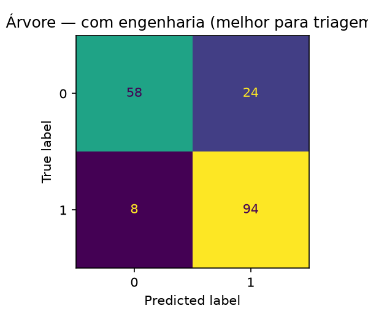
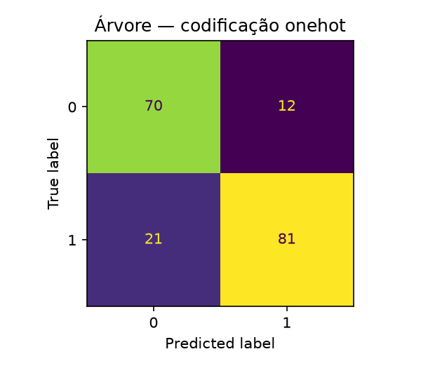

# Predição de Doença Cardíaca com Árvore de Decisão: tratamento de dados, hiperparâmetros e engenharia de atributos

**Disciplina:** Aprendizado de Máquina — PPGCC/UFPI  
**Professor:** Doutor Vinicius Ponte Machado  
**Data:** 26/10/2026  

**Integrantes:**

| Integrante | Matrícula |
|---|---|
| Arthur Fernando Elvas Bohn | 20261001997 |
| Diego Cordeiro de Oliveira | 20261002180 |
| Keoma de Sousa Coelho | 20261004952 |

**Base:** [Heart Failure Prediction — Kaggle](https://www.kaggle.com/datasets/fedesoriano/heart-failure-prediction)  
**Notebook:** `Arvore_Decisao_Heart_Failure_mlflow.ipynb`

---

## Lista de siglas e abreviaturas

| Sigla | Significado |
|---|---|
| **BP** | Pressão arterial (*Blood Pressure*) |
| **CV** | Validação cruzada (*Cross-Validation*) |
| **DAC** | Doença arterial coronariana |
| **ECG** | Eletrocardiograma |
| **F1** | Média harmônica entre precisão e revocação |
| **FC** | Frequência cardíaca |
| **FN** | Falso negativo |
| **FP** | Falso positivo |
| **HR** | Frequência cardíaca (*Heart Rate*) |
| **IC 95%** | Intervalo de confiança de 95% |
| **LVH** | Hipertrofia ventricular esquerda (*Left Ventricular Hypertrophy*) |
| **M/F** | Masculino/feminino |
| **MLflow** | Plataforma de rastreamento de experimentos de aprendizado de máquina |
| **PCA** | Análise de Componentes Principais (*Principal Component Analysis*) |
| **PPGCC/UFPI** | Programa de Pós-Graduação em Ciência da Computação da Universidade Federal do Piauí |
| **Prec. / Rec.** | Precisão / revocação (*recall*) |
| **SHAP** | *SHapley Additive exPlanations* |
| **SMOTE** | *Synthetic Minority Over-sampling Technique* (sobreamostragem sintética) |
| **SQLite** | Banco de dados relacional leve |
| **ST** | Segmento ST do eletrocardiograma |
| **TA/ATA/NAP/ASY** | Angina típica / angina atípica / dor não anginosa / assintomático |
| **TN / TP** | Verdadeiro negativo / verdadeiro positivo |
| **UCI** | *University of California, Irvine* (repositório de conjuntos de dados) |
| **Y/N** | Sim/não |

---

## 1. Introdução e problema

As doenças cardiovasculares estão entre as principais causas de morte no mundo. Um modelo de triagem que identifique pacientes com maior probabilidade de doença cardíaca pode apoiar a priorização de exames e reduzir o tempo até o tratamento. Neste trabalho, o problema é uma **classificação binária**:

- **Classe 1:** paciente com doença cardíaca (`HeartDisease = 1`);
- **Classe 0:** paciente sem doença (`HeartDisease = 0`).

O erro de maior gravidade clínica é o **falso negativo da classe 1**: classificar um paciente doente como "não doente". Nesse caso, o paciente deixa de ser tratado e pode evoluir para óbito. Por isso, além da acurácia, este trabalho dá atenção especial ao **recall e ao F1 da classe 1** (e ao F1 macro, que equilibra as duas classes).

**Objetivo:** avaliar uma **Árvore de Decisão**, combinando tratamento dos dados, ajuste de hiperparâmetros e engenharia de atributos, e registrar todos os experimentos no **MLflow** para comparar ganhos e perdas de forma reprodutível.

---

## 2. Base de dados

### 2.1 Origem e descrição

A base é a **Heart Failure Prediction** (Kaggle, fedesoriano), derivada do **UCI Heart Disease** (Detrano et al., 1989), combinando cinco bases clínicas (Cleveland, Hungria, Suíça, Long Beach VA e Statlog). O arquivo `bases/heart.csv` contém **918 registros** e **12 colunas** (11 atributos + alvo).

### 2.2 Dicionário de atributos

| Atributo | Tipo | Descrição |
|---|---|---|
| `Age` | Numérico | Idade (anos) |
| `Sex` | Categórico | Sexo (M/F) |
| `ChestPainType` | Categórico | Tipo de dor no peito (TA, ATA, NAP, ASY) |
| `RestingBP` | Numérico | Pressão arterial em repouso (mm Hg) |
| `Cholesterol` | Numérico | Colesterol sérico (mm/dl) |
| `FastingBS` | Binário | Glicemia em jejum > 120 mg/dl (1/0) |
| `RestingECG` | Categórico | ECG em repouso (Normal, ST, LVH) |
| `MaxHR` | Numérico | Frequência cardíaca máxima atingida |
| `ExerciseAngina` | Categórico | Angina induzida por exercício (Y/N) |
| `Oldpeak` | Numérico | Depressão do segmento ST induzida por exercício |
| `ST_Slope` | Categórico | Inclinação do segmento ST no pico (Up/Flat/Down) |
| `HeartDisease` | Binário | Alvo: 1 = doença, 0 = normal |

**Legenda das siglas dos atributos:** `TA` = angina típica; `ATA` = angina atípica; `NAP` = dor não anginosa; `ASY` = assintomático; `M/F` = masculino/feminino; `Y/N` = sim/não; `ST` = segmento ST do eletrocardiograma; `LVH` = hipertrofia ventricular esquerda (*Left Ventricular Hypertrophy*).

### 2.3 Distribuição e qualidade

| Classe | Registros | Proporção |
|---|---|---|
| 1 (com doença) | 508 | 55,34% |
| 0 (sem doença) | 410 | 44,66% |
| **Total** | **918** | **100%** |

- **Desbalanceamento leve:** a classe 1 é majoritária (55,34%).
- **Valores ausentes:** não há `NaN` original; porém `Cholesterol` tem **172 zeros** e `RestingBP` tem **1 zero**, fisiologicamente implausíveis. Esses zeros foram convertidos em `NaN` e imputados **dentro do pipeline** (sem vazamento).
- **Duplicatas:** 0.
- **Split:** 80/20 estratificado → 734 treino e 184 teste (102 da classe 1 e 82 da classe 0 no teste).

### 2.4 Estatísticas descritivas

| Variável | Média | Desvio | Mín. | Mediana | Máx. |
|---|---|---|---|---|---|
| Age | 53,51 | 9,43 | 28 | 54 | 77 |
| RestingBP | 132,40 | 18,51 | 0 | 130 | 200 |
| Cholesterol | 198,80 | 109,38 | 0 | 223 | 603 |
| FastingBS | 0,23 | 0,42 | 0 | 0 | 1 |
| MaxHR | 136,81 | 25,46 | 60 | 138 | 202 |
| Oldpeak | 0,89 | 1,07 | −2,6 | 0,6 | 6,2 |

---

## 3. Metodologia

### 3.1 Fluxo de processamento (pipeline)

O modelo é uma **Árvore de Decisão** (`DecisionTreeClassifier`) dentro de um fluxo de processamento (`Pipeline`):

1. **Pré-processamento numérico:** `SimpleImputer` (estratégia testada: mediana, média, moda) + `StandardScaler`;
2. **Pré-processamento categórico:** `OneHotEncoder` ou `OrdinalEncoder` (comparados);
3. **Modelo:** `DecisionTreeClassifier`.

Tudo é ajustado **somente no treino de cada partição (fold)** da validação cruzada (CV), evitando vazamento.

### 3.2 Validação e seleção

- Divisão (split) estratificada 80/20 (semente 42); o conjunto de teste é reservado até o fim.
- `RepeatedStratifiedKFold(5 folds × 2 repetições)` para a busca.
- Busca em grade (`GridSearchCV`) com métrica de reajuste (refit) **F1 da classe 1**; acurácia, precisão e recall também são medidos.
- Grade de hiperparâmetros: imputação (3) × `criterion` (2) × `max_depth` (4) × `min_samples_split` (3) × `min_samples_leaf` (3) × `max_features` (2) × `class_weight` (2) = **864 combinações** por codificação; 8.640 ajustes (*fits*) por codificação; **17.280 ajustes** no total (one-hot + ordinal).

**Valores testados em cada hiperparâmetro:**

| Parâmetro | Valores testados |
|---|---|
| `prep__num__imp__strategy` | `median`, `mean`, `most_frequent` |
| `modelo__criterion` | `gini`, `entropy` |
| `modelo__max_depth` | `3`, `5`, `7`, `None` |
| `modelo__min_samples_split` | `2`, `5`, `10` |
| `modelo__min_samples_leaf` | `1`, `3`, `5` |
| `modelo__max_features` | `None`, `sqrt` |
| `modelo__class_weight` | `None`, `balanced` |
- Avaliação no conjunto de teste: acurácia, precisão, recall e F1 para **as duas classes**, F1 macro, IC 95% do F1 da classe 1 (bootstrap com 1.000 reamostragens) e matriz de confusão.

### 3.3 Fases do notebook

| Fase | O que faz |
|---|---|
| 1. Configuração | Semente, MLflow (SQLite), pasta `resultados/execucao_<timestamp>/` |
| 2. Carga/limpeza | Lê `bases/heart.csv`; zeros de `Cholesterol`/`RestingBP` → `NaN` |
| 3. Preparação | `ColumnTransformer` (imputação + encoding + scaler), split 80/20, CV 5×2 |
| 4. Grid search | 864 combinações por codificação; one-hot e ordinal; log no MLflow |
| 5. Avaliação | Métricas das duas classes, IC 95%, matriz de confusão, importâncias |
| 6. Baseline | `DummyClassifier(most_frequent)` como referência |
| 7. Interpretação | Importâncias, plot da árvore, verificação de invariância à escala |
| 8. Ablação | Remove 1 atributo por vez; mesmos hiperparâmetros; ambas as classes |
| 9. Engenharia | 5 razões/interações clínicas; comparação sem/com |
| 10. Exportação | CSVs, JSON, PNGs e ZIP na pasta da execução; artefatos no MLflow |
| 11. MLflow | Runs pai/filhas, parâmetros, métricas, modelos e artefatos |

### 3.4 Engenharia de atributos testada

| Atributo derivado | Fórmula | Motivação |
|---|---|---|
| `FC_pct_teorica` | `MaxHR / (220 − Age)` | % da FC máxima teórica |
| `Chol_por_Idade` | `Cholesterol / Age` | colesterol relativo à idade |
| `BP_por_Idade` | `RestingBP / Age` | pressão relativa à idade |
| `Oldpeak_por_FC` | `Oldpeak / MaxHR` | depressão ST por batimento |
| `Angina_x_Oldpeak` | `(ExerciseAngina == 'Y') × Oldpeak` | interação angina × ST |

As razões são calculadas **linha a linha**, antes da divisão (split), sem vazamento.

---

## 4. Resultados

### 4.1 Busca em grade (grid search) e hiperparâmetros selecionados

| Codificação | Imputação | class_weight | criterion | max_depth | max_features | min_samples_leaf | min_samples_split |
|---|---|---|---|---|---|---|---|
| one-hot | mediana | balanced | entropy | 3 | None | 1 | 2 |
| ordinal | moda | None | gini | 3 | sqrt | 1 | 2 |

A árvore escolhida ficou **rasa (profundidade 3)** nas duas codificações. A busca avaliou 864 combinações por codificação (17.280 ajustes no total), com F1 da classe 1 como critério.

### 4.2 Comparação entre codificações one-hot e ordinal no conjunto de teste

| Codificação | Acurácia | Prec_c0 | Rec_c0 | F1_c0 | Prec_c1 | Rec_c1 | F1_c1 | F1_macro | IC95 F1_c1 |
|---|---|---|---|---|---|---|---|---|---|
| ordinal | 0,8098 | 0,8406 | 0,7073 | 0,7682 | 0,7913 | **0,8922** | **0,8387** | 0,8035 | 0,7817–0,8879 |
| one-hot | **0,8207** | 0,7692 | **0,8537** | 0,8092 | **0,8710** | 0,7941 | 0,8308 | **0,8200** | 0,7650–0,8865 |

**Interpretação:** a codificação **ordinal** tem maior **F1_c1** e **recall_c1** (melhor para não deixar doentes sem diagnóstico), enquanto a **one-hot** tem maior acurácia, precisão_c1 e F1_macro. Os intervalos de confiança do F1_c1 se sobrepõem, então a diferença não é conclusiva.

### 4.3 Referência (baseline) da classe majoritária

O classificador ingênuo (`DummyClassifier`, estratégia `most_frequent`) prediz sempre a classe 1:

| Métrica | Valor |
|---|---|
| Acurácia | 0,5543 |
| Precisão_c1 | 0,5543 |
| Recall_c1 | 1,0000 |
| F1_c1 | 0,7133 |
| F1_c0 | 0,0000 |
| F1_macro | 0,3566 |

Ou seja, classificar sempre a classe majoritária já resulta em F1_c1 = 0,71; o modelo precisa superar essa referência — e supera (0,8387 no ordinal). A referência tem **0 falsos negativos da classe 1** (revocação da classe 1 = 1), mas **82 falsos positivos** (toda a classe 0 incorreta), o que evidencia por que a acurácia isolada pode ser enganosa.

### 4.4 Ablação de atributos (seleção de variáveis)

Cada atributo foi removido individualmente, mantendo os melhores hiperparâmetros e `class_weight=None`.

| Cenário | Atributo removido | Acurácia | F1_c0 | F1_c1 | F1_macro |
|---|---|---|---|---|---|
| todos | nenhum | 0,8098 | 0,7682 | **0,8387** | 0,8035 |
| sem_RestingBP | RestingBP | 0,8207 | **0,8136** | 0,8272 | **0,8204** |
| sem_Cholesterol | Cholesterol | 0,8207 | **0,8136** | 0,8272 | **0,8204** |
| sem_FastingBS | FastingBS | 0,8207 | **0,8136** | 0,8272 | **0,8204** |
| sem_Age | Age | 0,8152 | 0,8068 | 0,8229 | 0,8149 |
| sem_ExerciseAngina | ExerciseAngina | 0,7989 | 0,7933 | 0,8042 | 0,7988 |
| sem_ST_Slope | ST_Slope | 0,7772 | 0,7630 | 0,7897 | 0,7764 |
| sem_MaxHR | MaxHR | 0,7500 | 0,6933 | 0,7890 | 0,7412 |
| sem_Sex | Sex | 0,7391 | 0,7073 | 0,7647 | 0,7360 |
| sem_ChestPainType | ChestPainType | 0,7391 | 0,7073 | 0,7647 | 0,7360 |
| sem_RestingECG | RestingECG | 0,7391 | 0,7073 | 0,7647 | 0,7360 |
| sem_Oldpeak | Oldpeak | 0,7391 | 0,7073 | 0,7647 | 0,7360 |

**Interpretação:**
- **Nenhuma remoção melhorou o F1_c1**: o conjunto completo é o melhor (0,8387).
- Remover `RestingBP`, `Cholesterol` ou `FastingBS` **melhora a acurácia (0,8207), o F1_c0 (0,8136) e o F1_macro (0,8204)**, mas **piora o recall/F1 da classe 1** — compromisso entre as classes.
- Remover `ST_Slope` ou `MaxHR` **piora** o F1_c1, indicando que são informativos.
- Remover `Sex`, `ChestPainType`, `RestingECG` ou `Oldpeak` leva o F1_c1 a 0,7647 (a árvore passa a usar outro caminho de decisão).
- Conclusão: para **maximizar F1_c1**, manter todos os atributos; para **equilibrar as classes (F1_macro)**, remover `RestingBP`/`Cholesterol`/`FastingBS` é uma alternativa.

### 4.5 Engenharia de atributos (razões e interações clínicas)

| Cenário | Nº atributos | Acurácia | F1_c0 | F1_c1 | F1_macro | F1_CV |
|---|---|---|---|---|---|---|
| sem_engenharia | 11 | 0,8098 | 0,7682 | 0,8387 | 0,8035 | **0,8604** |
| com_engenharia | 16 | **0,8261** | **0,7838** | **0,8545** | **0,8192** | 0,7946 |

**Melhora no conjunto de teste:** F1_c1 +0,0158 (0,8387 → 0,8545), recall_c1 +0,0294 (0,8922 → 0,9216), acurácia +0,0163, F1_macro +0,0157.

**Limitação importante:** o **F1 da validação cruzada (CV) apresentou redução** (0,8604 → 0,7946). Ou seja, a melhora no conjunto de teste **não é confirmada pela CV** e pode ser efeito da divisão específica (184 amostras). A engenharia deve ser tratada como **com potencial, porém não conclusiva**, até validação externa.

### 4.6 Matrizes de confusão e o erro de maior gravidade clínica

Com o teste de 184 pacientes (82 da classe 0 e 102 da classe 1):

| Modelo | TN | FP | FN (classe 1) | TP | Recall_c1 | F1_c1 | F1_CV |
|---|---|---|---|---|---|---|---|
| **com_engenharia** | 58 | 24 | **8** | 94 | **0,9216** | **0,8545** | 0,7946 |
| ordinal | 58 | 24 | 11 | 91 | 0,8922 | 0,8387 | **0,8604** |
| one-hot | 70 | 12 | 21 | 81 | 0,7941 | 0,8308 | 0,8550 |
| baseline | 0 | 82 | 0 | 102 | 1,0000 | 0,7133 | — |

**O erro de maior gravidade clínica:** o **falso negativo da classe 1** (paciente doente previsto como "não doente"). No conjunto de teste, o **`com_engenharia`** é o melhor para triagem: **8 falsos negativos** contra 11 do ordinal e 21 do one-hot, com o **mesmo número de falsos positivos (24)** e o maior **F1_c1 (0,8545)**. **Limitação:** o **F1 da CV apresentou redução** (0,7946 vs 0,8604 do ordinal), então a melhora no teste **não é confirmada pela CV** e pode refletir a variância do conjunto de teste reservado. Os dois melhores para triagem são **`com_engenharia` e ordinal** (8 e 11 falsos negativos); a escolha é um compromisso entre desempenho no teste e robustez na CV, e exige validação externa.

### 4.7 Síntese das transformações e impacto nas métricas

Em consonância com a solicitação da atividade, a tabela abaixo resume as principais transformações de preparação dos dados e o efeito nas métricas (melhoria ou piora):

| Transformação | Antes | Depois | Efeito |
|---|---|---|---|
| Codificação one-hot → ordinal | F1_c1 0,8308 | **0,8387** | ganho no F1_c1/recall |
| Imputação (mediana × moda) | — | — | escolhida pela grade |
| `class_weight=balanced` | ≈ igual | ≈ igual | **sem efeito** (desbalanceamento leve) |
| Escalonamento (`StandardScaler`) | idêntico | idêntico | **invariante** (árvore) |
| Remover `RestingBP`/`Cholesterol`/`FastingBS` | F1_c1 0,8387 | 0,8272 | **piora F1_c1**, melhora F1_macro |
| Remover `ST_Slope`/`MaxHR` | F1_c1 0,8387 | 0,7897 / 0,7890 | **piora** |
| Engenharia de atributos | F1_c1 0,8387 | **0,8545** (teste) | melhora no teste, **redução na CV** |
| Variação de hiperparâmetros one-hot (`max_depth=4`, `min_samples_leaf=10`) | F1 0,8308 | 0,8119 | **piora** |

---

## 5. MLflow: registro e tabulação dos experimentos

Todos os experimentos foram registrados no MLflow, no experimento **`heart_failure_arvore_decisao`**, com rastreamento (tracking) local em SQLite (`mlflow.db`) e artefatos em `mlruns/`.

- **111 execuções (runs)** registradas (execuções pai e filhas).
- Cada execução (run) guarda: **parâmetros** (codificação, imputação, hiperparâmetros, atributo removido, engenharia, `class_weight`), **métricas** (F1, acurácia, precisão, recall, F1 macro, IC 95%), **modelo** (`mlflow.sklearn.log_model`) e **artefatos** (CSVs, JSON, PNGs, ZIP).
- A tabela completa está em **`docs/mlflow_runs.csv`** (exportada via `mlflow.search_runs`), com as colunas de execução (run), status, data, parâmetros e métricas.

**Execuções principais:** `arvore_onehot`, `arvore_ordinal`, `baseline_classe_majoritaria`, `ablacao_atributos` (com 12 execuções filhas), `engenharia_features` (com `sem_engenharia` e `com_engenharia`) e `relatorio_artefatos`.

---

## 6. Avaliação comparativa entre execuções

| Execução | O que mudou | Melhor F1_c1 | F1_macro | Efeito |
|---|---|---|---|---|
| `20261022_081800` | Versão inicial: one-hot × ordinal + baseline | 0,8387 | — | referência (só classe 1) |
| `20261022_083734` | + ablação com `class_weight` None/balanced | 0,8387 | 0,8035 | `balanced` ≈ `None` |
| `20261022_090449` | Ablação simplificada (sem `balanced`) | 0,8387 | — | foco didático |
| `20261022_093147` | + engenharia de atributos | **0,8545** (com) | **0,8192** (com) | melhora no teste, **redução na CV** |
| `20261022_094826` | Variação de hiperparâmetros one-hot (`max_depth=4`, `min_samples_leaf=10`) | 0,8119 (one-hot) | — | **piorou** o teste |
| `20261026_075517` | Métricas para as duas classes (versão final) | 0,8387 (ordinal) / 0,8545 (com eng.) | 0,8035 / 0,8192 | versão consolidada |

**Considerações sobre a evolução:**
1. Os **hiperparâmetros** escolhidos pela grade ficaram estáveis (profundidade 3), exceto a variação de `094826`, que **piorou** o teste.
2. A **engenharia de atributos** foi a única mudança que **apresentou melhora no conjunto de teste** (F1_c1 0,8387 → 0,8545), mas **apresentou redução na CV** (0,8604 → 0,7946) — ganho **não robusto**.
3. A **ablação** mostrou que remover atributos **não melhora o F1_c1**; só melhora o F1_macro ao custo da revocação (recall) da classe 1.
4. `class_weight='balanced'` **não teve efeito** relevante, coerente com o desbalanceamento leve (55/45).
5. A mudança para **reportar as duas classes** alterou a interpretação: o que parecia "melhor" pela classe 1 nem sempre é melhor no F1_macro.

---

## 7. Discussão e trabalhos relacionados

| Trabalho | Contribuição | Relação com este trabalho |
|---|---|---|
| Qadri et al. (2023), IEEE Access | Técnica de engenharia de atributos (*feature engineering*) para predição de doença cardíaca | Justifica a criação de atributos derivados |
| Abass & Bathla (2025), Springer | Aprendizado de máquina + engenharia de atributos | Reforça a engenharia como etapa |
| Gárate-Escamilla et al. (2020), Informatics in Medicine Unlocked | Seleção de atributos + PCA | Compara seleção/transformação |
| Hasnat et al. (2025), arXiv | Engenharia de atributos + SHAP + árvores substitutas | Interpretabilidade |
| Page et al. (1970), Circulation | Idade, colesterol e triglicerídeos na predição de DAC | Base para `Chol_por_Idade` |
| Folsom et al. (2003), Diabetes Care | Fatores de risco para DAC | Contexto clínico |
| Detrano et al. (1989) / Janosi et al. (1988) | Base UCI Heart Disease | Origem dos dados |
| Fox et al. (1971) | Fórmula `FCmax ≈ 220 − idade` | Base de `FC_pct_teorica` |

**Justificativa das razões:** as variáveis originais (`MaxHR`, `Oldpeak`, `Cholesterol`, `RestingBP`, `ExerciseAngina`) são indicadores clínicos conhecidos. As razões buscam normalizar por idade/FC e capturar interações (angina × depressão ST), o que ajuda a árvore a representar relações "diagonais" com menos cortes. A literatura apoia a engenharia de atributos em doença cardíaca, mas **as razões específicas aqui testadas são hipóteses exploratórias** e precisam de validação externa.

**Limitações:**
- Base pequena (918) e teste de apenas 184 pacientes → intervalos de confiança largos.
- Uma única árvore (sem ensemble) e sem validação externa.
- A engenharia apresentou melhora no conjunto de teste, mas redução na CV → ganho não conclusivo.
- Não foram testados ajuste de limiar, SMOTE (*Synthetic Minority Over-sampling Technique*) ou outros modelos.

---

## 8. Conclusão e recomendações

- **Melhor modelo para triagem no conjunto de teste:** `com_engenharia` (codificação ordinal + 5 atributos derivados), com **8 falsos negativos**, revocação da classe 1 (*recall_c1*) = 0,9216 e F1_c1 = 0,8545 — mesmo número de falsos positivos (24) do ordinal.
- **Modelo mais robusto na CV:** ordinal sem engenharia, com F1_CV = 0,8604 (o `com_engenharia` tem F1_CV = 0,7946).
- **Engenharia de atributos:** apresentou melhora no conjunto de teste, mas **não confirmou o ganho na CV** → tratar como com potencial e não conclusiva.
- **Ablação:** manter todos os atributos maximiza o F1_c1; remover `RestingBP`/`Cholesterol`/`FastingBS` melhora o F1_macro, mas aumenta o risco de falso negativo da classe 1.
- **Recomendação clínica:** para triagem, priorizar **recall/F1 da classe 1** (`com_engenharia` no teste, ordinal como alternativa robusta), avaliar **ajuste de limiar** e validar em base externa antes de uso real.
- **MLflow:** as 111 execuções (runs) permitem reproduzir e comparar todos os experimentos.

---

## 9. Referências

1. FEDESORIANO. **Heart Failure Prediction Dataset**. Kaggle, 2021. Disponível em: https://www.kaggle.com/datasets/fedesoriano/heart-failure-prediction
2. DETRANO, R. et al. International application of a new probability algorithm for the diagnosis of coronary artery disease. **American Journal of Cardiology**, 1989.
3. JANOSI, A.; STEINBRUNN, W.; PFISTERER, M.; DETRANO, R. **Heart Disease**. UCI Machine Learning Repository, 1988.
4. QADRI, A. M. et al. Effective Feature Engineering Technique for Heart Disease Prediction With Machine Learning. **IEEE Access**, 2023.
5. ABASS, A.; BATHLA, G. Heart Disease Prediction Using Machine Learning with Feature Engineering. **Springer**, 2025.
6. GÁRATE-ESCAMILLA, A. K.; HAJJAM EL HASSANI, A.; ANDRÈS, E. Classification models for heart disease prediction using feature selection and PCA. **Informatics in Medicine Unlocked**, 2020.
7. HASNAT, M. A. et al. Interpretable Heart Disease Prediction via a Weighted Ensemble Model. **arXiv:2511.01947**, 2025.
8. PAGE, I. H. et al. Prediction of Coronary Heart Disease Based on Clinical Suspicion, Age, Total Cholesterol, and Triglyceride. **Circulation**, 1970.
9. FOLSOM, A. R. et al. Prediction of Coronary Heart Disease in Middle-Aged Adults With Diabetes. **Diabetes Care**, 2003.
10. FOX, S. M.; NAUGHTON, J. P.; HASKELL, W. L. Physical activity and the prevention of coronary heart disease. **Annals of Clinical Research**, 1971.

